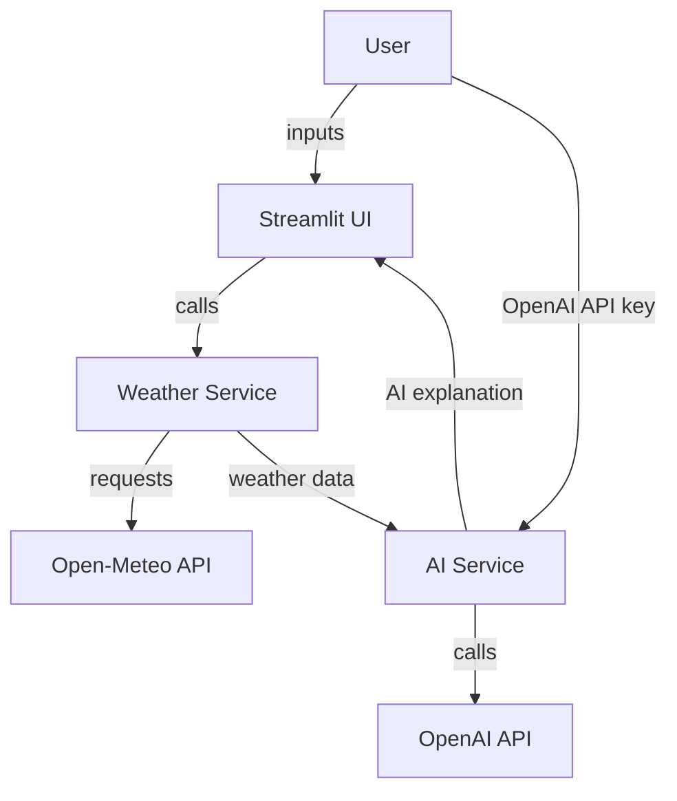

# AI Weather Assistant

Discover current weather conditions and get intelligent weather insights powered by AI.

---

## Features
- Enter a city name and select temperature unit (°C/°F)
- Enter your own OpenAI API key (not persistently stored)
- Retrieves real-time weather from Open-Meteo
- AI-powered weather explanation using OpenAI
- Robust error handling and input validation
- Beginner-friendly, clean UI (Streamlit)
- Automated tests (pytest, all APIs mocked)
- Ready for Streamlit Community Cloud deployment

## Architecture



- The OpenAI API key is **never** sent to Open-Meteo.

## Technology Stack
- Python 3.12+
- Streamlit
- OpenAI Python SDK
- Requests
- Pytest
- Git, GitHub

## Project Structure

```
ai-weather-assistant/
|-- app.py
|-- weather_service.py
|-- ai_service.py
|-- requirements.txt
|-- README.md
|-- PROMPT.md
|-- .gitignore
|-- .streamlit/
|   |-- config.toml
|-- tests/
    |-- test_weather_service.py
    |-- test_ai_service.py
```

## Prerequisites
- Python 3.12 (recommended) or another Python version supported by Streamlit
- PowerShell (for Windows setup)
- OpenAI API key (get from https://platform.openai.com/api-keys)

## Local Setup Instructions

1. **Open the project folder in Visual Studio Code.**
2. **Create a virtual environment:**
   ```powershell
   python -m venv .venv
   ```
3. **Activate the virtual environment:**
   ```powershell
   .\.venv\Scripts\Activate.ps1
   ```
   If PowerShell blocks activation with an execution-policy error, run:
   ```powershell
   Set-ExecutionPolicy -ExecutionPolicy RemoteSigned -Scope CurrentUser
   ```
   Then try activating again.
4. **Upgrade pip and install dependencies:**
   ```powershell
   python -m pip install --upgrade pip
   pip install -r requirements.txt
   ```
5. **Run the application:**
   ```powershell
   streamlit run app.py
   ```
6. **Run automated tests:**
   ```powershell
   pytest
   ```

## How to Obtain and Use an OpenAI API Key
- Sign up at https://platform.openai.com/
- Go to API Keys and create a new key
- Copy the key and enter it in the app when prompted
- The key is sent to OpenAI only when you submit the weather request; it is not written to a file or deployment secret
- The password field clears after submission

## How Weather Data is Retrieved
- The first form submission uses Open-Meteo Geocoding API to resolve city names
- If the city is ambiguous, select the correct region and country before continuing
- The weather request uses Open-Meteo Forecast API current observations and the selected temperature unit
- No API key is required for Open-Meteo, subject to its usage terms and limits

## How the AI Explanation is Generated
- The submitted key is used by the server-side OpenAI Python SDK to call the Responses API
- The app sends actual weather data and the selected location; it never sends the key to Open-Meteo or includes it in the prompt
- The AI generates a concise, practical weather summary
- The model is configured by `OPENAI_MODEL` in `ai_service.py`; change it to a model available to your OpenAI account

## GitHub Setup
1. **Initialize git and commit:**
   ```powershell
   git init
   git add .
   git commit -m "Initial commit"
   ```
2. **Create a new GitHub repository** (via GitHub web)
3. **Add the remote and push:**
   ```powershell
   git remote add origin https://github.com/yourusername/ai-weather-assistant.git
   git branch -M main
   git push -u origin main
   ```

## Streamlit Community Cloud Deployment
1. Sign in at https://share.streamlit.io/
2. Click "New app"
3. Select your GitHub repo and branch
4. Set `app.py` as the entry point
5. Deploy
6. If deployment fails, check the app's Manage app logs
7. Commit and push changes to the selected branch; Community Cloud will redeploy the app

Do not add an OpenAI key to Community Cloud secrets. Each user supplies their own key in the app.

## Troubleshooting
- **Activation blocked:** Use `Set-ExecutionPolicy` as above
- **API errors:** Check your OpenAI API key, usage, and quota
- **Weather errors:** Try a different city or check your internet connection

## API Usage and Cost Considerations
- Open-Meteo's standard public API does not require a separate API key; follow its applicable usage terms and limits
- OpenAI API usage may incur charges (see your OpenAI dashboard)
- ChatGPT Plus and OpenAI API billing are separate
- Monitor your API usage and set spending limits as needed

## Security Limitations
- The app does not intentionally copy the key into application session state, write it to disk, log it, or send it to the weather provider. Streamlit temporarily handles the submitted widget value server-side, and the password field clears after submission
- Streamlit Community Cloud is shared hosting; password masking alone does **not** guarantee complete credential isolation from the app operator or hosting runtime
- Use appropriately scoped API keys, monitor usage, and revoke any key you suspect has been exposed

## Known Limitations
- No persistent user accounts or API key storage
- Only current weather (no forecasts)
- AI explanation is only as accurate as the provided data
- Streamlit Community Cloud resources are limited

---

